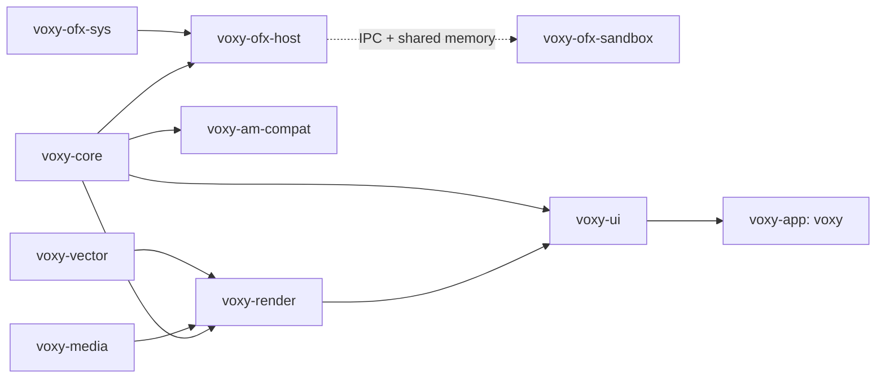
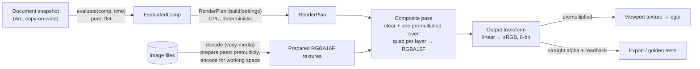

# voXY

voXY is a desktop motion-graphics and video editor for Windows, Linux and
macOS, written in Rust.

- **Workflow:** layered, keyframe-driven animation of shapes, images, video,
  audio and text, with effects, blend modes and fast export.
- **OpenFX:** hosts third-party OpenFX image-effect plugins.
- **Alight Motion:** opens and re-exports Alight Motion projects and presets
  for interoperability.

voXY is an original product. Its name, artwork, icons and theme are its own.

> **Status: Milestone 2c.** Milestone 1 is complete: the project model,
> undo/redo, `.voxy` save/load, the GPU compositor and the application
> shell. Milestone 2a adds the keyframe and interpolation model: hold,
> linear and cubic-bezier timing with ease presets, plus arc-length
> ("speed-aware") motion paths. Milestone 2b adds the timeline panel and
> 2c the graph editor; on-canvas motion paths and transform gizmos come
> next. See [`docs/design-proposal.md`](docs/design-proposal.md) for
> the plan.

## What works today

**Application:** a window titled **voXY**, built on eframe/egui.
- Dockable, resizable panels: Viewport, Timeline (a layer list for now),
  Properties and Media.
- Menus: File (New, Open, Save, Save As, Quit), Edit (Undo/Redo with the step
  name), Layer (New Solid, Import Image, Delete) and Composition (working
  color space).
- Shortcuts:

  | Action | Shortcut |
  |---|---|
  | Undo | Ctrl/⌘+Z |
  | Redo | Ctrl/⌘+Shift+Z, or Ctrl+Y |
  | New, Open, Save, Save As, Quit | Ctrl/⌘ + N, O, S, Shift+S, Q |
  | Delete the selected layer | Del |

- Editing transform and solid properties, including color.
- Keyframes, from the Properties panel:
  - the stopwatch turns animation on or off;
  - the diamond adds or deletes a key at the current time;
  - right-clicking the diamond sets interpolation or an ease preset;
  - the arrows on either side of the diamond jump to the previous or next
    key.

  The Timeline panel has a time scrubber, and the Left/Right arrow keys step
  one frame.
- The Timeline panel (Milestone 2b):
  - a time ruler: click or drag to move the playhead, snapped to frames;
  - one bar per layer: drag to move it, drag its edges to trim;
  - expandable per-property lanes with keyframe diamonds: click to select
    (Shift/Ctrl adds), drag to move the selection, Delete removes it;
  - Ctrl+scroll zooms around the pointer, scroll pans, Fit shows everything.

  Every drag is one undo step. Keyframes cannot be dragged onto each other
  or before time 0.
- The Graph Editor panel (Milestone 2c), a tab next to Timeline:
  - **value or speed graph** of the selected layer's animated properties,
    one curve per component (X red, Y green, Z blue). In value mode, drag a
    keyframe in time (snapped to frames) and in value. Speed mode shows the
    rate of change, which for position is the speed along the motion path;
  - **ease curve** of the selected segment as a normalized cubic-bezier
    with two draggable handles (overshoot allowed), its `cubic-bezier(...)`
    readout, a speed preview and preset buttons. Dragging a handle on a
    linear segment turns it into a Bézier segment.

  The segment edited is the one starting at the selected keyframe, or the
  one under the playhead.
- A prompt before discarding unsaved changes.

**Undo/redo for every edit.** Each edit records a document snapshot, and
snapshots share all unchanged data. A slider or drag gesture collapses into one
undo step.

**Keyframes** (`voxy-core`), all times integer flicks:
- per-segment hold, linear or cubic-bezier timing, with handles stored on the
  keys;
- ease presets: CSS ease family, easy ease, back in and back out;
- motion paths for position and anchor point, parameterized by arc length, so
  speed along the path follows the ease curve;
- a value at a key's time is returned exactly.

**`.voxy` project files:** versioned JSON, written atomically, and validated
when loaded and saved. See [`docs/voxy-format.md`](docs/voxy-format.md).

**GPU compositor** (wgpu):
- Renders in premultiplied RGBA16F.
- The working color space is a per-project setting: linear light, the default
  for voXY projects, or sRGB compatibility.
- Preview and export share one code path. Preview may only lower the
  resolution.

**Tests:**
- unit and property-based tests for the model;
- golden-image tests for the renderer, run headless on lavapipe in CI;
- CI on Windows, Linux, and macOS (both arm64 and x64).

**Playback:**
- Space plays and pauses; the playhead follows the **audio master clock**,
  and video frames are scheduled against it.
- Audio is output through `cpal`. Without an output device, a timer drives
  the same clock.
- Audio decoding (FFmpeg) is sample-accurate and resamples to the device
  rate.

**Alight Motion interoperability (groundwork):**
- a lossless XML tree and zip/bare-file container: unedited files write back
  byte-for-byte;
- sample tooling: `cargo xtask am-inspect` and `cargo xtask am-diff`.

Parsing Alight Motion's actual format waits for real sample files; see
[`docs/am-format.md`](docs/am-format.md) for the requested batch.

## Building

You need a Rust **stable** toolchain, 1.97 or newer, from <https://rustup.rs>,
plus **FFmpeg development libraries (3.0 to 9.0)** and **libclang**, which
the FFmpeg bindings use at build time. voXY links FFmpeg dynamically.
Development builds can use any FFmpeg; release builds ship an LGPL build
(see [`LICENSING.md`](LICENSING.md)). To build without video support, use
`cargo build -p voxy-media --no-default-features`.

```sh
cargo run -p voxy-app --release             # start voXY
cargo run -p voxy-app --release -- my.voxy  # open a project
cargo test --workspace                      # all tests
cargo clippy --workspace --all-targets      # lints (CI uses -D warnings)
```

Want something to look at? Generate a demo project with
`cargo run -p voxy-core --example demo_project -- demo.voxy`.

### Windows 10+ (x64)

Install Rust with the MSVC toolchain (Visual Studio Build Tools with
"Desktop development with C++") and LLVM (for libclang). For FFmpeg:
1. Download a *shared* LGPL build, for example `ffmpeg-n7.1-latest-win64-lgpl-shared-7.1.zip`
   from <https://github.com/BtbN/FFmpeg-Builds/releases>.
2. Set `FFMPEG_DIR` to the folder you unpacked it into.
3. Add its `bin` folder to `PATH`.

voXY renders through Direct3D 12 or Vulkan.

### Linux: Ubuntu 22.04+ (x64)

```sh
# build
sudo apt install pkg-config clang libavcodec-dev libavformat-dev libavutil-dev \
  libswscale-dev libswresample-dev libavfilter-dev libavdevice-dev libasound2-dev
# run
sudo apt install libxkbcommon-x11-0 libwayland-client0 libvulkan1 mesa-vulkan-drivers
```

Running voXY also needs a Vulkan or OpenGL ES driver. Hardware video
decoding uses VAAPI (or CUDA) when available.

`mesa-vulkan-drivers` provides lavapipe, a CPU Vulkan driver. It lets the GPU
tests run on machines without a GPU (`WGPU_BACKEND=vulkan`).

### macOS 12+ (Apple Silicon and Intel)

Install the Xcode command-line tools (`xcode-select --install`) and
`brew install ffmpeg pkg-config`. voXY renders through Metal and decodes video
with VideoToolbox.

## Pinned GPU stack

voXY uses **exactly one `wgpu` version**, shared by the compositor, by vello
(vector rasterization, from Milestone 4) and by eframe/egui-wgpu (the UI):

| Crate | Version | Its `wgpu` |
|---|---|---|
| `wgpu` | **30.0.1** | — |
| `vello` | 0.11.0 | `^30.0.0` |
| `eframe` / `egui-wgpu` | 0.36.2 | `^30.0` |
| `egui` / `egui_dock` | 0.36.2 / 0.21.1 | — |

Sharing one `wgpu` lets the viewport display compositor output with no copy,
because it is the same `wgpu::Device`. Two compile-time checks enforce it:
- `voxy-render` asserts that `vello::wgpu` is the workspace `wgpu`;
- `voxy-ui` asserts that `egui_wgpu::wgpu` is the workspace `wgpu`.

If the versions ever drift apart, the build fails instead of quietly linking
two copies. To upgrade, move all of the crates above together in
`[workspace.dependencies]`, then check with `cargo tree -i wgpu`, which must
show a single version.

## Architecture

| Crate | Role |
|---|---|
| `voxy-core` | Document model, integer time (flicks), properties, commands, snapshot undo/redo, evaluation, `.voxy` I/O. No GPU, media or UI dependencies. |
| `voxy-render` | wgpu compositor: render planning, WGSL shaders, image preparation, output transform, readback. |
| `voxy-vector` | Vector geometry and text (kurbo, parley, i_overlay, vello). Placeholder until Milestone 4. |
| `voxy-media` | Image decoding; FFmpeg video decoding (demux, decode, hardware acceleration, frame-accurate seeking, flick timestamps). Audio and encoding come later in Milestone 3. |
| `voxy-ofx-sys` / `voxy-ofx-host` / `voxy-ofx-sandbox` | OpenFX bindings, host, and out-of-process plugin runner (one per bundle). From Milestone 7. |
| `voxy-am-compat` | Alight Motion interoperability. From Compat 2a, built only from real sample files. |
| `voxy-ui` | eframe/egui shell: docking, panels, menus, shortcuts, viewport. |
| `voxy-app` | The `voxy` executable. |
| `xtask` | Developer tasks (`cargo xtask licenses`). |



### Render pipeline



- **Deterministic:** the same project, frame and machine/driver always produce
  identical pixels, and a test checks this. Across different GPUs, output is
  near-identical, and the golden tests allow a small tolerance.
- **Color:** the working buffer holds linear light by default. With the
  sRGB-compatibility working space, blending happens on sRGB-encoded values
  instead. Alight Motion imports will default to whichever space the golden
  fidelity tests show matches.
- **Coming next:**
  - effects, masks, mattes and precomps (Milestones 4–5) turn the single
    chain into a DAG of nodes with content hashes, used for caching;
  - a dedicated render thread arrives with playback (Milestone 3). Today the
    UI thread renders only when the document or the viewport size changes.

## Tests

- `cargo test --workspace` runs everything.
- Golden images live in `tests/golden/render/`.
  - `VOXY_UPDATE_GOLDEN=1` regenerates them. Inspect the result before
    committing.
  - `VOXY_REQUIRE_GPU=1` turns a missing GPU adapter into a test failure. CI
    sets it on Linux.
- Property-based tests (`proptest`) run random edit sequences through undo,
  redo and save/load. Set `PROPTEST_CASES` to change how many sequences run.

## Licensing

See [`LICENSING.md`](LICENSING.md). It covers the dependency policy, OpenFX
headers (BSD-3-Clause), FFmpeg (an LGPL build, dynamically linked) and codec
patent notes. The generated dependency list is in
[`docs/third-party-licenses.md`](docs/third-party-licenses.md).
